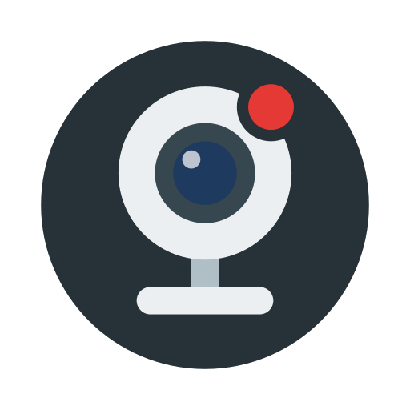
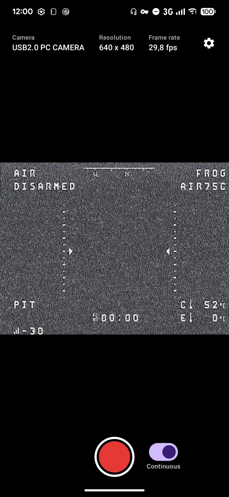
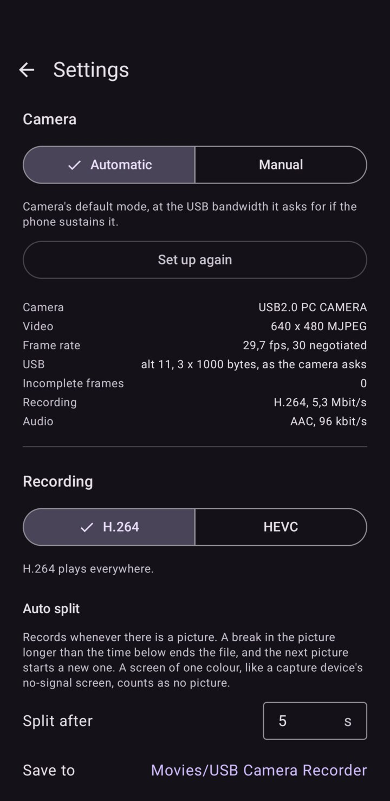

#  USB Camera Recorder

Android app that shows and records USB video class (UVC) cameras, like webcams and video capture devices, to MP4.

- Automatic camera setup with manual fallback
- MP4 recording in H.264 or HEVC
- Audio from the camera, if it has any, never from the phone's microphone
- Auto split into separate files at signal loss
- Background and screen-off recording
- Custom save folder

<p>
  
  
</p>

## Install

Requires Android 10 or newer with USB host (OTG) support. Download the APK from
[Releases](https://github.com/Garbaz/usb-camera-recorder/releases).

## Usage

Plug in the camera and allow the app to use it. The record button starts and stops a recording; with Auto split
switched on, it starts a session that records whenever there is a picture.

If the picture stays black or broken, set the camera to Manual in Settings and try a lower USB bandwidth.
Please [open an issue](https://github.com/Garbaz/usb-camera-recorder/issues) with the camera and phone
model if that was needed.

## Build

```sh
git clone --recurse-submodules https://github.com/Garbaz/usb-camera-recorder.git
cd usb-camera-recorder
./gradlew assembleDebug
```

Needs the Android SDK with NDK 27.1 and CMake 3.22.1. [libusb](https://github.com/libusb/libusb) and
[libuvc](https://github.com/libuvc/libuvc) are git submodules in `app/src/main/cpp/external`.

## License

GNU General Public License v3, see [LICENSE](LICENSE).

The app bundles [libusb](https://libusb.info) (LGPL-2.1-or-later) and [libuvc](https://github.com/libuvc/libuvc) (BSD-3-Clause).
